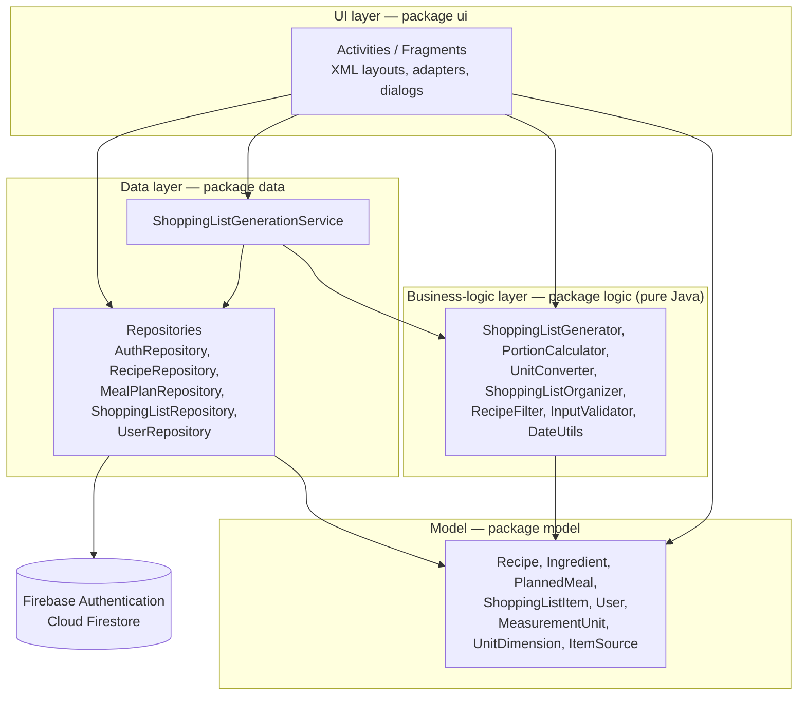
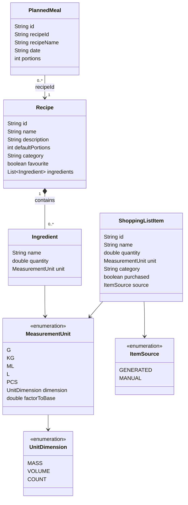
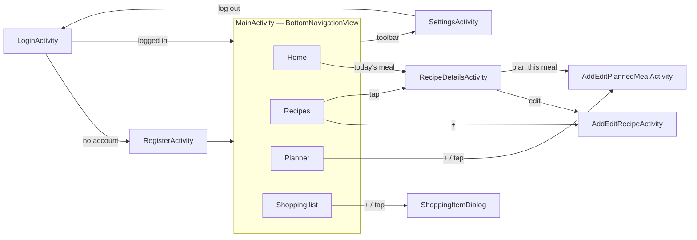
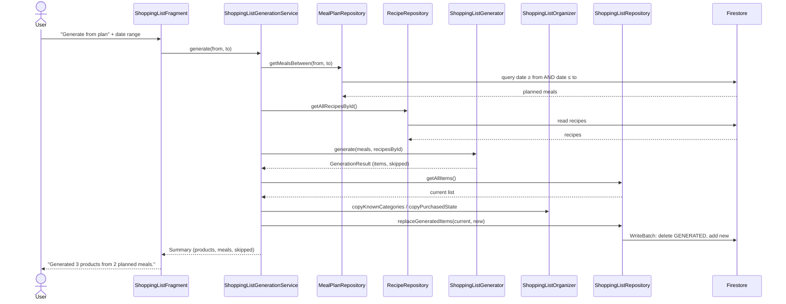

# Architecture – Meal Planner

Engineering project: *Projekt i implementacja aplikacji mobilnej do planowania posiłków i zarządzania listą zakupów*.

This document describes the technical design of the application: the technologies, the layered
architecture, the responsibilities of the classes, the data model and Firestore structure, the
shopping-list generation algorithm, and the most important design decisions.

---

## 1. Purpose of the application

The application lets a user:

1. create recipes with ingredients (quantity + measurement unit) and a default number of portions,
2. plan meals for chosen days with a chosen number of portions,
3. **automatically generate one combined shopping list** from the planned meals. Quantities are
   recalculated for the planned portions, compatible units are normalised, and identical
   ingredients are merged,
4. manage the shopping list manually: add, edit, delete, mark as purchased, clear, group by category.

The engineering core of the project is the shopping-list generation mechanism (section 6).

---

## 2. Technologies

| Area | Technology | Version |
|---|---|---|
| Language | Java (no Kotlin) | Java 11 language level |
| User interface | XML layouts, Material Components 3 | material 1.14.0, appcompat 1.8.0 |
| Lists | RecyclerView | 1.4.0 |
| Authentication | Firebase Authentication (email / password) | Firebase BoM 35.2.0 |
| Database | Cloud Firestore (with offline cache) | Firebase BoM 35.2.0 |
| Unit tests | JUnit 4 + JaCoCo coverage | 4.13.2 |
| Build | Gradle (Kotlin DSL, version catalog), Android Gradle Plugin | Gradle 9.6, AGP 9.5.1 |
| SDK | `minSdk 24` (Android 7.0), `targetSdk / compileSdk 37` | |
| Version control | Git | |

---

## 3. Layered architecture

The code is divided into four layers. Each layer may use only the layers below it.



| Layer | Package | Responsibility | May use |
|---|---|---|---|
| **UI** | `ui.*` | Shows data, reacts to user actions, validates input with `InputValidator`, shows messages | data, logic, model |
| **Data** | `data` | The only place that talks to Firebase. Reads and writes documents, converts them into model objects | logic, model, Firebase |
| **Business logic** | `logic` | All calculations and rules. **No Android and no Firebase imports**, so it is testable with plain JUnit | model |
| **Model** | `model` | Plain Java classes (POJOs) describing the data | – |

**Why this structure.**

- **Separation of responsibilities.** An Activity never calculates quantities and never builds
  Firestore paths.
- **Testability.** The shopping-list algorithm runs on any JVM without starting Android
  (77 unit tests, 95 % line coverage of `logic`).
- **Replaceability.** Moving to another database would change only the `data` package.
- **Simplicity.** There are no frameworks for dependency injection or reactive programming. Every
  class can be understood with basic Java knowledge.

---

## 4. Packages and classes

```
pl.projectinz.mealplanner
├── MealPlannerApp                 applies the saved theme at start-up
├── model/                         data classes (Firestore documents)
├── logic/                         business logic (pure Java, unit-tested)
├── data/                          Firebase access (repositories + generation service)
└── ui/
    ├── auth/                      login, registration
    ├── main/                      main screen with bottom navigation
    ├── home/                      start section
    ├── recipes/                   recipe list, details, add / edit
    ├── planner/                   weekly planner, add / edit planned meal
    ├── shopping/                  shopping list, product dialog
    ├── settings/                  account, language, theme, logout
    └── common/                    helpers shared by several screens
```

### 4.1 Model (`model`)

| Class | Description |
|---|---|
| `Recipe` | ID, name, description, default portions, category, favourite flag, list of ingredients, creation time |
| `Ingredient` | Name, quantity (`double`), unit. Embedded in the recipe, so it has no own ID |
| `PlannedMeal` | ID, recipe ID, copy of the recipe name, date `"yyyy-MM-dd"`, number of portions |
| `ShoppingListItem` | ID, name, quantity, unit (optional), category, purchased flag, source |
| `User` | Email, display name, date range of the current shopping list |
| `MeasurementUnit` | Enum `G, KG, ML, L, PCS`. Each value knows its dimension and its factor to the base unit |
| `UnitDimension` | Enum `MASS, VOLUME, COUNT`. Only units of the same dimension can be converted |
| `ItemSource` | Enum `GENERATED, MANUAL`. Shows whether a product comes from the plan or was added by the user |



### 4.2 Business logic (`logic`)

| Class | Responsibility |
|---|---|
| `PortionCalculator` | `required = quantity × selectedPortions / defaultPortions`. Rejects portions ≤ 0 and negative quantities |
| `UnitConverter` | Converts to base units (g, ml, pcs), checks compatibility, converts between units, chooses a readable unit (1500 g → 1.5 kg) |
| `Quantity` | Value object: amount + unit (the result of normalisation) |
| `ShoppingListGenerator` | **The core algorithm**: from planned meals and recipes to one combined list (section 6) |
| `GenerationResult` | The generated products and the meals that had to be skipped |
| `ShoppingListOrganizer` | Groups products by category and orders them; remembers categories; detects whether a recalculated list differs from the stored one; keeps the "purchased" mark |
| `RecipeFilter` | Searches recipes by name, category or ingredient; favourites filter; sorting |
| `InputValidator` | Validation and parsing of user input: email, password, portions (1–99), quantities (0 < q ≤ 100 000, accepts `,` and `.`) |
| `QuantityFormatter` | Formats numbers for the selected language ("1.5" / "1,5") |
| `DateUtils` | Dates as `"yyyy-MM-dd"` text: conversion from the date picker (UTC), adding days, start of the week, display formatting |

### 4.3 Data layer (`data`)

| Class | Responsibility |
|---|---|
| `FirestorePaths` | One place that defines all Firestore paths |
| `DataCallback<T>` | Callback interface returning the result of an asynchronous operation (`onSuccess` / `onError`) |
| `AuthRepository` | Registration, login, logout, current user (Firebase Authentication) |
| `UserRepository` | Profile document `users/{uid}`; remembers the date range of the shopping list |
| `RecipeRepository` | CRUD for recipes, live listening, favourite flag, all recipes as a map ID → recipe |
| `MealPlanRepository` | CRUD for planned meals, date-range queries, renaming and deleting the meals of a recipe |
| `ShoppingListRepository` | CRUD for products, purchased flag, deleting purchased products, replacing generated products (batched writes) |
| `ShoppingListGenerationService` | Connects the repositories with the algorithm: loads meals and recipes, runs `ShoppingListGenerator`, saves the result (section 6.5) |

### 4.4 User interface (`ui`)

| Screen | Class | Layout |
|---|---|---|
| Login (start screen) | `LoginActivity` | `activity_login.xml` |
| Registration | `RegisterActivity` | `activity_register.xml` |
| Main screen + bottom navigation | `MainActivity` | `activity_main.xml` |
| Home | `HomeFragment` | `fragment_home.xml` |
| Recipe list | `RecipesFragment`, `RecipeAdapter` | `fragment_recipes.xml`, `item_recipe.xml` |
| Recipe details | `RecipeDetailsActivity` | `activity_recipe_details.xml` |
| Add / edit recipe | `AddEditRecipeActivity` | `activity_add_edit_recipe.xml`, `item_ingredient_input.xml` |
| Weekly planner | `PlannerFragment`, `PlannerAdapter` | `fragment_planner.xml` |
| Add / edit planned meal | `AddEditPlannedMealActivity` | `activity_add_edit_planned_meal.xml` |
| Shopping list | `ShoppingListFragment`, `ShoppingListAdapter`, `ShoppingItemDialog` | `fragment_shopping_list.xml` |
| Settings | `SettingsActivity` | `activity_settings.xml` |

Shared helpers in `ui.common`:

| Class | Purpose |
|---|---|
| `EdgeToEdgeHelper` | Keeps content clear of the system bars and the keyboard. Edge-to-edge drawing is mandatory from Android 15 |
| `UnitLabels` | Converts `MeasurementUnit` into a translated label ("pcs" / "szt.") |
| `LanguageHelper` | English / Polish switch (per-app language API) |
| `ThemeHelper` | Light / dark / system theme |
| `NetworkMonitor` | Detects missing internet; drives the offline banner |
| `UnsavedChangesGuard` | Shows "Discard changes?" when leaving a form with unsaved changes |



The four main sections are Fragments swapped by `MainActivity`. Forms and details are separate
Activities. This was chosen over the Navigation component because it is simpler to understand.

---

## 5. Firestore database

The detailed structure and its justification are in [`firestore.md`](firestore.md). Summary:

```
users/{uid}                              User (incl. shoppingListFrom / shoppingListTo)
users/{uid}/recipes/{recipeId}           Recipe with embedded ingredients
users/{uid}/mealPlans/{plannedMealId}    PlannedMeal
users/{uid}/shoppingItems/{itemId}       ShoppingListItem (one active list)
```

- All data of a user lives under `users/{uid}`. One security rule
  (`request.auth.uid == userId`) guarantees that users see only their own data.
- **Ingredients are embedded** in the recipe document. They are always read and written together
  with the recipe, there are few of them, and one read returns the complete recipe.
- **Dates are `"yyyy-MM-dd"` strings**, so a date range is a simple text range query on one field
  (no composite index and no time-zone shifts).
- The recipe name is **copied into the planned meal** (denormalisation), so the planner shows
  names without reading every recipe. A rename is propagated with a batched update.

---

## 6. Shopping-list generation algorithm

### 6.1 Problem

Input: the planned meals in a date range and the user's recipes.
Output: one list in which each product appears once, with the total quantity needed for all meals,
recalculated for the planned portions and expressed in a readable unit.

Example from the specification:

| Recipe A (2 portions) | Recipe B (2 portions) | → Shopping list |
|---|---|---|
| Chicken 200 g | Chicken 300 g | **Chicken 500 g** |
| Rice 100 g | Onion 1 pcs | **Rice 100 g** |
| | | **Onion 1 pcs** |

### 6.2 Idea

1. **Recalculate** every ingredient for the planned portions (`PortionCalculator`).
2. **Convert to the base unit** of its dimension (`UnitConverter`): kg → g, l → ml. Quantities
   in the same base unit can be added.
3. **Identify the product** with the key *normalised name + dimension*, e.g. `"chicken|MASS"`.
   The name is trimmed, multiple spaces are collapsed, and it is converted to lower case, so
   "Chicken" and " chicken " are the same product. The dimension keeps "chicken 200 g" and
   "chicken 1 pcs" apart, because grams cannot be converted into pieces.
4. **Sum** the base quantities per key in a hash map.
5. **Normalise** each sum to a readable unit: ≥ 1000 g → kg, ≥ 1000 ml → l.
6. Round to 3 decimal places (hides floating-point errors such as 0.30000000000000004) and sort
   by name.

### 6.3 Pseudocode

```
function generate(plannedMeals, recipesById):
    sums ← empty LinkedHashMap<key, ProductSum>
    skipped ← empty list

    for each meal in plannedMeals:
        recipe ← recipesById[meal.recipeId]
        if recipe = null or recipe.defaultPortions ≤ 0 or meal.portions ≤ 0:
            skipped.add(meal)                      // e.g. the recipe was deleted
            continue
        for each ingredient in recipe.ingredients:
            if ingredient is invalid: continue     // empty name, quantity ≤ 0, no unit
            q    ← ingredient.quantity × meal.portions / recipe.defaultPortions
            base ← q × ingredient.unit.factorToBase
            key  ← normalise(ingredient.name) + "|" + ingredient.unit.dimension
            if key not in sums:
                sums[key] ← new ProductSum(cleanName(ingredient.name), dimension)
            sums[key].baseQuantity ← sums[key].baseQuantity + base

    items ← empty list
    for each sum in sums.values():
        (amount, unit) ← normalise(sum.baseQuantity, sum.dimension)   // 1500 g → 1.5 kg
        items.add(new ShoppingListItem(sum.name, round3(amount), unit, GENERATED))

    sort items by name (case-insensitive)
    return GenerationResult(items, skipped)
```

### 6.4 Complexity

Let *n* be the number of ingredients in all planned meals and *k* the number of distinct products
(k ≤ n).

- Recipe lookup and hash-map access are O(1) on average, so the main loop is **O(n)**.
- Building the result is O(k), and sorting it is **O(k log k)**.
- **Total time: O(n + k log k). Memory: O(k).**

For a typical week (about 20 meals × 8 ingredients = 160 ingredients) the calculation takes well
under a millisecond on the device.

### 6.5 Integration with the database

`ShoppingListGenerator` only calculates. Loading and saving the data is done by
`ShoppingListGenerationService`:



Rules applied when saving:

- Only products with `source = GENERATED` are replaced. **Manual products are never changed.**
- Deletes and inserts are sent in `WriteBatch`es (atomic, at most 500 operations per batch), so the
  user never sees a half-updated list.
- **Categories are remembered**: a new product gets the category that the user gave to a product
  with the same name before.
- **The "purchased" mark is kept** only when the product still has the same quantity and unit. If
  the plan now needs more, the product becomes "to buy" again.

### 6.6 Automatic update after changes in the plan

The chosen date range is stored in `users/{uid}` (`shoppingListFrom`, `shoppingListTo`). Every time
the Shopping tab is opened, `ShoppingListGenerationService.refresh()` recalculates the list for that
range. `ShoppingListOrganizer.hasSameGeneratedContent()` compares the result with the stored list,
and the database is written **only when something changed**: different portions, a new or deleted
meal, or an edited recipe. The shopping list therefore always matches the meal plan, without
unnecessary writes.

---

## 7. Measurement units

```
MeasurementUnit   dimension   factorToBase   base unit
G                 MASS        1              g
KG                MASS        1000           g
ML                VOLUME      1              ml
L                 VOLUME      1000           ml
PCS               COUNT       1              pcs
```

- Conversion is defined by data (the factor in the enum), not by `if`/`switch` chains. Adding
  e.g. a teaspoon unit requires only one new enum constant.
- Units of different dimensions are never converted. `UnitConverter.convert(100, G, PCS)` throws
  `IllegalArgumentException`.
- Firestore stores the enum name (`"KG"`). The label shown to the user comes from string resources,
  so the same data is shown as "pcs" in English and "szt." in Polish.

---

## 8. Asynchronous data access and offline mode

- Firebase never blocks the UI thread. Repositories return results through `DataCallback<T>`.
- Lists use Firestore **snapshot listeners**. The screen is updated automatically after every
  change, including changes made on another screen. Listeners are registered in `onStart()` and
  removed in `onStop()`, so there is no Firestore traffic while a screen is not visible.
- Firestore keeps a **local cache**. Writes are shown immediately and sent to the server when the
  connection is available. Forms therefore close right after saving instead of waiting for the
  server, and errors are reported with a message. `NetworkMonitor` shows a banner when the device
  is offline.

---

## 9. Validation and error handling

| Where | What |
|---|---|
| `InputValidator` (unit-tested) | Non-empty texts, email format, password ≥ 6 characters, portions 1–99, quantities 0 < q ≤ 100 000, decimal comma and dot |
| Forms | Errors are shown directly under the field (`TextInputLayout.setError`); saving is blocked until the input is valid |
| Product dialog | A quantity requires a unit and vice versa; the dialog stays open until the input is valid |
| `AuthErrorMapper` | Firebase exceptions → understandable messages (wrong credentials, email in use, no network, too many attempts) |
| Generator | Invalid data (deleted recipe, 0 portions, empty ingredient) is skipped and reported, never causes a crash |
| Data consistency | Deleting a recipe deletes its planned meals; renaming a recipe renames its planned meals |
| Navigation | `UnsavedChangesGuard` protects forms; delete operations require confirmation; deleting a product offers "Undo" |

---

## 10. Internationalisation and appearance

- All texts are in `res/values/strings.xml` (English) and `res/values-pl/strings.xml` (Polish),
  including Polish plural forms (`<plurals>`: 1 porcja, 2 porcje, 5 porcji).
- The language is switched inside the app with the official per-app language API
  (`AppCompatDelegate.setApplicationLocales`). On Android 13+ the app also appears in the system
  "App languages" settings (`generateLocaleConfig`).
- Material 3 green colour scheme with light and dark variants. The user can choose light, dark or
  system theme.
- Numbers and dates are formatted for the selected language ("1,5 kg", "poniedziałek, 9 lis").

---

## 11. Security

- Authentication: Firebase Authentication with email and password.
- Authorisation: Firestore security rules (`firestore.rules`):

  ```
  match /users/{userId}/{document=**} {
    allow read, write: if request.auth != null && request.auth.uid == userId;
  }
  ```

  Even a modified client cannot read or change another user's data, because the rules are enforced
  on the server.
- Release builds are shrunk with R8. The model classes are kept (`src/main/keepRules/rules.keep`)
  because Firestore creates them by reflection.

---

## 12. Main design decisions

| Decision | Alternative | Reason |
|---|---|---|
| Layers + repositories, logic in pure Java | MVVM with ViewModel / LiveData | Simpler for a student; the logic is still fully separated and testable |
| Callbacks (`DataCallback`) | RxJava, coroutines | No extra library; understandable with basic Java |
| Fragments switched manually | Jetpack Navigation component | Fewer concepts and files; the navigation is simple |
| Ingredients embedded in the recipe | Separate `ingredients` sub-collection | Always used together; one read; atomic save |
| Dates as `"yyyy-MM-dd"` text | Firestore `Timestamp` | A meal belongs to a day; range queries without time-zone problems; works on API 24 without `java.time` |
| One active shopping list | Several saved lists | Matches how people shop; simpler screens and data |
| Products identified by name + dimension | Global product catalogue | No catalogue needed; works for any ingredient the user types |
| Recalculation when the Shopping tab is opened | Recalculate after every plan change | One place in the code; no work while the list is not visible; no unnecessary writes |
| Search on the device | Firestore queries | Firestore has no substring search; a personal recipe list is small |

---

## 13. Limitations and possible extensions

- Products are matched by name, so "tomato" and "tomatoes" are different products. Possible
  extension: a product dictionary with synonyms.
- Only mass, volume and pieces are supported. Units such as spoons or cups would need an
  approximate conversion per product.
- The shopping list cannot be shared with other people (e.g. a family). Possible extension: a
  shared list document with several members in the security rules.
- Automated UI tests (Espresso) and tests against the Firebase Emulator Suite could complement the
  unit tests.
