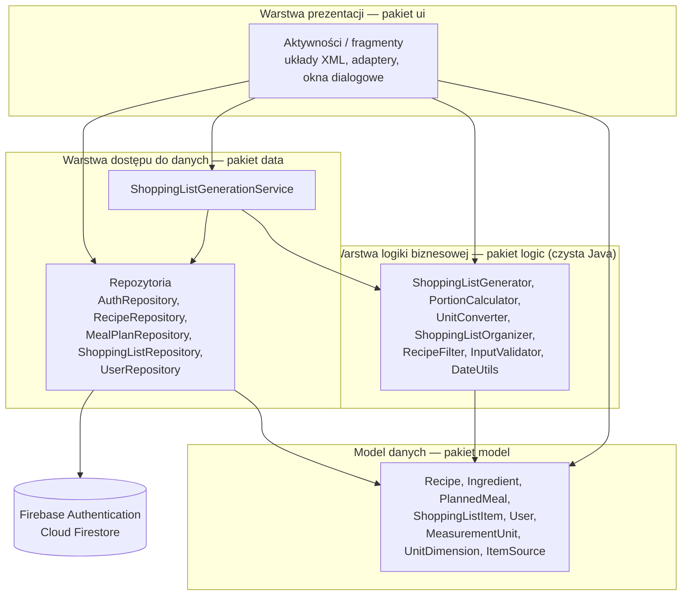
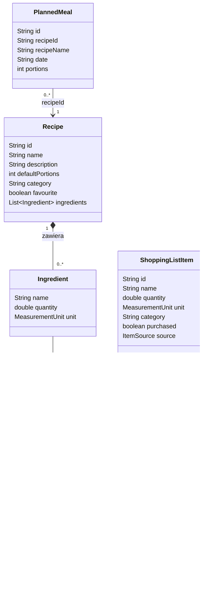
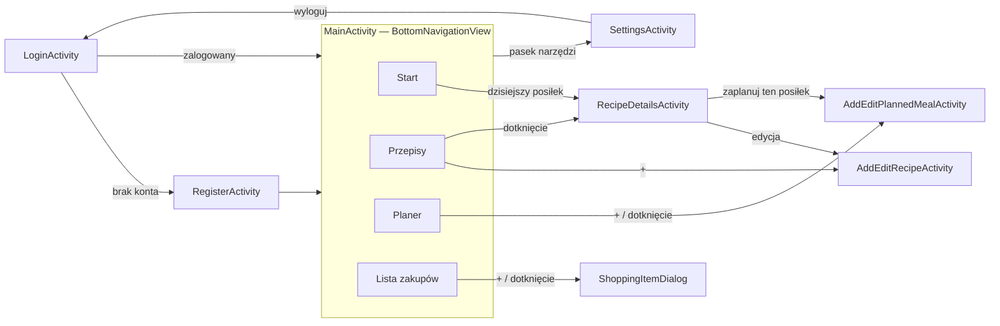
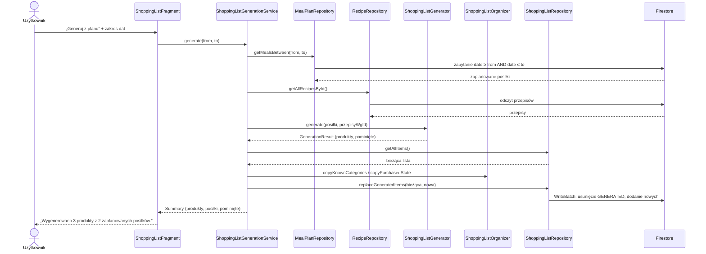

# Architektura aplikacji – Planer posiłków

Projekt inżynierski: *Projekt i implementacja aplikacji mobilnej do planowania posiłków i zarządzania listą zakupów*.

Dokument opisuje projekt techniczny aplikacji: zastosowane technologie, architekturę warstwową,
odpowiedzialności klas, model danych i strukturę bazy Firestore, algorytm generowania listy
zakupów oraz najważniejsze decyzje projektowe.

---

## 1. Cel aplikacji

Aplikacja umożliwia użytkownikowi:

1. tworzenie przepisów ze składnikami (ilość i jednostka miary) oraz z domyślną liczbą porcji,
2. planowanie posiłków na wybrane dni z wybraną liczbą porcji,
3. **automatyczne wygenerowanie jednej zbiorczej listy zakupów** na podstawie zaplanowanych
   posiłków. Ilości są przeliczane dla zaplanowanej liczby porcji, zgodne jednostki są
   normalizowane, a identyczne składniki łączone,
4. ręczne zarządzanie listą zakupów: dodawanie, edycję, usuwanie, oznaczanie produktów jako
   kupionych, usuwanie kupionych oraz grupowanie według kategorii.

Najważniejszą częścią inżynierską projektu jest mechanizm generowania listy zakupów (rozdział 6).

---

## 2. Technologie

| Obszar | Technologia | Wersja |
|---|---|---|
| Język programowania | Java (bez Kotlina) | poziom języka Java 11 |
| Interfejs użytkownika | Układy XML, Material Components 3 | material 1.14.0, appcompat 1.8.0 |
| Listy | RecyclerView | 1.4.0 |
| Uwierzytelnianie | Firebase Authentication (e-mail i hasło) | Firebase BoM 35.2.0 |
| Baza danych | Cloud Firestore (z pamięcią podręczną offline) | Firebase BoM 35.2.0 |
| Testy jednostkowe | JUnit 4 oraz pomiar pokrycia JaCoCo | 4.13.2 |
| Budowanie | Gradle (Kotlin DSL, katalog wersji), Android Gradle Plugin | Gradle 9.6, AGP 9.5.1 |
| SDK | `minSdk 24` (Android 7.0), `targetSdk / compileSdk 37` | |
| Kontrola wersji | Git | |

---

## 3. Architektura warstwowa

Kod podzielono na cztery warstwy. Każda warstwa może korzystać wyłącznie z warstw położonych niżej.



| Warstwa | Pakiet | Odpowiedzialność | Może korzystać z |
|---|---|---|---|
| **Prezentacji** | `ui.*` | Wyświetla dane, obsługuje działania użytkownika, sprawdza dane wejściowe za pomocą `InputValidator`, wyświetla komunikaty | data, logic, model |
| **Dostępu do danych** | `data` | Jedyne miejsce komunikacji z Firebase. Odczytuje i zapisuje dokumenty oraz zamienia je na obiekty modelu | logic, model, Firebase |
| **Logiki biznesowej** | `logic` | Wszystkie obliczenia i reguły. **Brak importów Androida i Firebase**, dzięki czemu klasy można testować zwykłym JUnit | model |
| **Model** | `model` | Proste klasy Javy (POJO) opisujące dane | – |

**Uzasadnienie takiej struktury.**

- **Rozdzielenie odpowiedzialności.** Aktywność nigdy nie przelicza ilości i nie buduje ścieżek
  Firestore.
- **Testowalność.** Algorytm listy zakupów działa na dowolnej maszynie JVM bez uruchamiania
  Androida (77 testów jednostkowych, 95% pokrycia linii pakietu `logic`).
- **Wymienialność.** Zmiana bazy danych wymagałaby modyfikacji wyłącznie pakietu `data`.
- **Prostota.** Nie zastosowano bibliotek do wstrzykiwania zależności ani programowania
  reaktywnego. Każdą klasę można zrozumieć przy podstawowej znajomości Javy.

---

## 4. Pakiety i klasy

```
pl.projectinz.mealplanner
├── MealPlannerApp                 ustawia zapisany motyw przy starcie aplikacji
├── model/                         klasy danych (dokumenty Firestore)
├── logic/                         logika biznesowa (czysta Java, testy jednostkowe)
├── data/                          dostęp do Firebase (repozytoria i serwis generowania)
└── ui/
    ├── auth/                      logowanie, rejestracja
    ├── main/                      ekran główny z dolną nawigacją
    ├── home/                      sekcja startowa
    ├── recipes/                   lista przepisów, szczegóły, dodawanie / edycja
    ├── planner/                   planer tygodniowy, dodawanie / edycja posiłku
    ├── shopping/                  lista zakupów, okno dialogowe produktu
    ├── settings/                  konto, język, motyw, wylogowanie
    └── common/                    klasy pomocnicze używane przez kilka ekranów
```

### 4.1 Model (`model`)

| Klasa | Opis |
|---|---|
| `Recipe` | Identyfikator, nazwa, opis, domyślna liczba porcji, kategoria, znacznik ulubionego, lista składników, czas utworzenia |
| `Ingredient` | Nazwa, ilość (`double`), jednostka. Osadzony w przepisie, dlatego nie ma własnego identyfikatora |
| `PlannedMeal` | Identyfikator, identyfikator przepisu, kopia nazwy przepisu, data `"yyyy-MM-dd"`, liczba porcji |
| `ShoppingListItem` | Identyfikator, nazwa, ilość, jednostka (opcjonalna), kategoria, znacznik zakupu, źródło |
| `User` | E-mail, nazwa wyświetlana, zakres dat bieżącej listy zakupów |
| `MeasurementUnit` | Typ wyliczeniowy `G, KG, ML, L, PCS`. Każda wartość zna swój wymiar i przelicznik na jednostkę bazową |
| `UnitDimension` | Typ wyliczeniowy `MASS, VOLUME, COUNT` (masa, objętość, sztuki). Przeliczać można tylko jednostki tego samego wymiaru |
| `ItemSource` | Typ wyliczeniowy `GENERATED, MANUAL`. Określa, czy produkt pochodzi z planu, czy został dodany przez użytkownika |



### 4.2 Logika biznesowa (`logic`)

| Klasa | Odpowiedzialność |
|---|---|
| `PortionCalculator` | `potrzebna ilość = ilość × wybrane porcje / domyślne porcje`. Odrzuca liczby porcji ≤ 0 i ujemne ilości |
| `UnitConverter` | Przeliczanie na jednostki bazowe (g, ml, szt.), sprawdzanie zgodności jednostek, przeliczanie między jednostkami, wybór czytelnej jednostki (1500 g → 1,5 kg) |
| `Quantity` | Obiekt wartości: ilość i jednostka (wynik normalizacji) |
| `ShoppingListGenerator` | **Główny algorytm**: od zaplanowanych posiłków i przepisów do jednej zbiorczej listy (rozdział 6) |
| `GenerationResult` | Wygenerowane produkty oraz posiłki, które trzeba było pominąć |
| `ShoppingListOrganizer` | Grupowanie produktów według kategorii i ich porządkowanie; zapamiętywanie kategorii; wykrywanie, czy przeliczona lista różni się od zapisanej; zachowanie oznaczenia „kupione” |
| `RecipeFilter` | Wyszukiwanie przepisów po nazwie, kategorii lub składniku; filtr ulubionych; sortowanie |
| `InputValidator` | Walidacja i parsowanie danych wprowadzanych przez użytkownika: e-mail, hasło, liczba porcji (1–99), ilości (0 < q ≤ 100 000, akceptowany przecinek i kropka) |
| `QuantityFormatter` | Formatowanie liczb zgodnie z wybranym językiem („1.5” / „1,5”) |
| `DateUtils` | Daty jako tekst `"yyyy-MM-dd"`: konwersja z selektora dat (UTC), dodawanie dni, początek tygodnia, formatowanie do wyświetlenia |

### 4.3 Warstwa dostępu do danych (`data`)

| Klasa | Odpowiedzialność |
|---|---|
| `FirestorePaths` | Jedno miejsce definiujące wszystkie ścieżki Firestore |
| `DataCallback<T>` | Interfejs wywołania zwrotnego zwracający wynik operacji asynchronicznej (`onSuccess` / `onError`) |
| `AuthRepository` | Rejestracja, logowanie, wylogowanie, bieżący użytkownik (Firebase Authentication) |
| `UserRepository` | Dokument profilu `users/{uid}`; zapamiętuje zakres dat listy zakupów |
| `RecipeRepository` | Operacje CRUD na przepisach, nasłuchiwanie zmian, znacznik ulubionego, wszystkie przepisy jako mapa identyfikator → przepis |
| `MealPlanRepository` | Operacje CRUD na zaplanowanych posiłkach, zapytania o zakres dat, zmiana nazwy i usuwanie posiłków danego przepisu |
| `ShoppingListRepository` | Operacje CRUD na produktach, znacznik zakupu, usuwanie kupionych produktów, zastępowanie produktów wygenerowanych (zapisy wsadowe) |
| `ShoppingListGenerationService` | Łączy repozytoria z algorytmem: wczytuje posiłki i przepisy, uruchamia `ShoppingListGenerator`, zapisuje wynik (rozdział 6.5) |

### 4.4 Interfejs użytkownika (`ui`)

| Ekran | Klasa | Układ |
|---|---|---|
| Logowanie (ekran startowy) | `LoginActivity` | `activity_login.xml` |
| Rejestracja | `RegisterActivity` | `activity_register.xml` |
| Ekran główny z dolną nawigacją | `MainActivity` | `activity_main.xml` |
| Start | `HomeFragment` | `fragment_home.xml` |
| Lista przepisów | `RecipesFragment`, `RecipeAdapter` | `fragment_recipes.xml`, `item_recipe.xml` |
| Szczegóły przepisu | `RecipeDetailsActivity` | `activity_recipe_details.xml` |
| Dodawanie / edycja przepisu | `AddEditRecipeActivity` | `activity_add_edit_recipe.xml`, `item_ingredient_input.xml` |
| Planer tygodniowy | `PlannerFragment`, `PlannerAdapter` | `fragment_planner.xml` |
| Dodawanie / edycja posiłku | `AddEditPlannedMealActivity` | `activity_add_edit_planned_meal.xml` |
| Lista zakupów | `ShoppingListFragment`, `ShoppingListAdapter`, `ShoppingItemDialog` | `fragment_shopping_list.xml` |
| Ustawienia | `SettingsActivity` | `activity_settings.xml` |

Klasy pomocnicze w pakiecie `ui.common`:

| Klasa | Przeznaczenie |
|---|---|
| `EdgeToEdgeHelper` | Odsuwa zawartość od pasków systemowych i klawiatury. Rysowanie od krawędzi do krawędzi jest obowiązkowe od Androida 15 |
| `UnitLabels` | Zamienia `MeasurementUnit` na przetłumaczoną etykietę („pcs” / „szt.”) |
| `LanguageHelper` | Przełączanie języka angielski / polski (API języka aplikacji) |
| `ThemeHelper` | Motyw jasny / ciemny / zgodny z systemem |
| `NetworkMonitor` | Wykrywa brak połączenia z internetem i steruje komunikatem o pracy offline |
| `UnsavedChangesGuard` | Wyświetla pytanie „Odrzucić zmiany?” przy opuszczaniu formularza z niezapisanymi zmianami |



Cztery główne sekcje są fragmentami przełączanymi przez `MainActivity`. Formularze i ekrany
szczegółów są osobnymi aktywnościami. Rozwiązanie to wybrano zamiast komponentu Navigation,
ponieważ jest prostsze do zrozumienia.

---

## 5. Baza danych Firestore

Szczegółowa struktura bazy i jej uzasadnienie znajdują się w pliku [`firestore.md`](firestore.md).
Podsumowanie:

```
users/{uid}                              User (w tym shoppingListFrom / shoppingListTo)
users/{uid}/recipes/{recipeId}           Recipe z osadzonymi składnikami
users/{uid}/mealPlans/{plannedMealId}    PlannedMeal
users/{uid}/shoppingItems/{itemId}       ShoppingListItem (jedna aktywna lista)
```

- Wszystkie dane użytkownika znajdują się pod `users/{uid}`. Jedna reguła bezpieczeństwa
  (`request.auth.uid == userId`) gwarantuje, że użytkownik widzi wyłącznie własne dane.
- **Składniki są osadzone** w dokumencie przepisu. Zawsze są odczytywane i zapisywane razem
  z przepisem, jest ich niewiele, a jeden odczyt zwraca kompletny przepis.
- **Daty są tekstami `"yyyy-MM-dd"`**, więc zakres dat to proste zapytanie zakresowe na jednym
  polu (bez indeksu złożonego i bez przesunięć związanych ze strefą czasową).
- Nazwa przepisu jest **kopiowana do zaplanowanego posiłku** (denormalizacja), dzięki czemu planer
  wyświetla nazwy bez odczytywania każdego przepisu. Zmiana nazwy jest propagowana zapisem wsadowym.

---

## 6. Algorytm generowania listy zakupów

### 6.1 Problem

Dane wejściowe: zaplanowane posiłki z wybranego zakresu dat oraz przepisy użytkownika.
Wynik: jedna lista, na której każdy produkt występuje raz, z łączną ilością potrzebną do
przygotowania wszystkich posiłków, przeliczoną dla zaplanowanych porcji i wyrażoną w czytelnej
jednostce.

Przykład ze specyfikacji:

| Przepis A (2 porcje) | Przepis B (2 porcje) | → Lista zakupów |
|---|---|---|
| Kurczak 200 g | Kurczak 300 g | **Kurczak 500 g** |
| Ryż 100 g | Cebula 1 szt. | **Ryż 100 g** |
| | | **Cebula 1 szt.** |

### 6.2 Idea rozwiązania

1. **Przeliczenie** każdego składnika dla zaplanowanej liczby porcji (`PortionCalculator`).
2. **Zamiana na jednostkę bazową** danego wymiaru (`UnitConverter`): kg → g, l → ml. Ilości
   w tej samej jednostce bazowej można dodawać.
3. **Identyfikacja produktu** kluczem *znormalizowana nazwa + wymiar*, np. `"chicken|MASS"`.
   Nazwa jest przycinana, wielokrotne spacje są zastępowane pojedynczą, a litery zamieniane na
   małe, więc „Kurczak” i „ kurczak ” to ten sam produkt. Wymiar rozdziela „kurczak 200 g”
   i „kurczak 1 szt.”, ponieważ gramów nie da się przeliczyć na sztuki.
4. **Sumowanie** ilości bazowych dla każdego klucza w tablicy mieszającej.
5. **Normalizacja** każdej sumy do czytelnej jednostki: ≥ 1000 g → kg, ≥ 1000 ml → l.
6. Zaokrąglenie do 3 miejsc po przecinku (ukrywa błędy arytmetyki zmiennoprzecinkowej, np.
   0.30000000000000004) i sortowanie według nazwy.

### 6.3 Pseudokod

```
funkcja generuj(zaplanowanePosiłki, przepisyWgId):
    sumy ← pusta LinkedHashMap<klucz, SumaProduktu>
    pominięte ← pusta lista

    dla każdego posiłku w zaplanowanePosiłki:
        przepis ← przepisyWgId[posiłek.recipeId]
        jeśli przepis = null lub przepis.defaultPortions ≤ 0 lub posiłek.portions ≤ 0:
            pominięte.dodaj(posiłek)               // np. przepis został usunięty
            kontynuuj
        dla każdego składnika w przepis.ingredients:
            jeśli składnik jest niepoprawny: kontynuuj   // pusta nazwa, ilość ≤ 0, brak jednostki
            q      ← składnik.quantity × posiłek.portions / przepis.defaultPortions
            bazowa ← q × składnik.unit.factorToBase
            klucz  ← normalizuj(składnik.name) + "|" + składnik.unit.dimension
            jeśli klucz nie występuje w sumy:
                sumy[klucz] ← nowa SumaProduktu(oczyśćNazwę(składnik.name), wymiar)
            sumy[klucz].ilośćBazowa ← sumy[klucz].ilośćBazowa + bazowa

    produkty ← pusta lista
    dla każdej sumy w sumy.wartości():
        (ilość, jednostka) ← normalizuj(suma.ilośćBazowa, suma.wymiar)   // 1500 g → 1,5 kg
        produkty.dodaj(nowy ShoppingListItem(suma.nazwa, zaokrąglij3(ilość), jednostka, GENERATED))

    posortuj produkty według nazwy (bez rozróżniania wielkości liter)
    zwróć GenerationResult(produkty, pominięte)
```

### 6.4 Złożoność obliczeniowa

Niech *n* oznacza liczbę składników we wszystkich zaplanowanych posiłkach, a *k* liczbę
różnych produktów (k ≤ n).

- Wyszukanie przepisu i dostęp do tablicy mieszającej mają średnio koszt O(1), więc główna
  pętla ma złożoność **O(n)**.
- Utworzenie wyniku kosztuje O(k), a jego posortowanie **O(k log k)**.
- **Łączna złożoność czasowa: O(n + k log k). Złożoność pamięciowa: O(k).**

Dla typowego tygodnia (ok. 20 posiłków × 8 składników = 160 składników) obliczenie trwa na
urządzeniu znacznie poniżej jednej milisekundy.

### 6.5 Współpraca z bazą danych

`ShoppingListGenerator` wyłącznie wykonuje obliczenia. Wczytywaniem i zapisem danych zajmuje się
`ShoppingListGenerationService`:



Reguły stosowane podczas zapisu:

- Zastępowane są tylko produkty z `source = GENERATED`. **Produkty dodane ręcznie nigdy nie są
  zmieniane.**
- Usunięcia i dodania są wysyłane w paczkach `WriteBatch` (atomowych, najwyżej 500 operacji na
  paczkę), więc użytkownik nie widzi listy w stanie częściowo zaktualizowanym.
- **Kategorie są zapamiętywane**: nowy produkt otrzymuje kategorię, którą użytkownik wcześniej
  przypisał produktowi o tej samej nazwie.
- **Oznaczenie „kupione” jest zachowywane** tylko wtedy, gdy produkt ma nadal tę samą ilość
  i jednostkę. Jeżeli plan wymaga teraz więcej, produkt ponownie trafia do pozycji „do kupienia”.

### 6.6 Automatyczna aktualizacja po zmianach w planie

Wybrany zakres dat jest zapisany w `users/{uid}` (`shoppingListFrom`, `shoppingListTo`). Przy każdym
otwarciu zakładki z listą zakupów metoda `ShoppingListGenerationService.refresh()` przelicza listę
dla tego zakresu. `ShoppingListOrganizer.hasSameGeneratedContent()` porównuje wynik z zapisaną
listą, a zapis do bazy następuje **tylko wtedy, gdy coś się zmieniło**: liczba porcji, dodany lub
usunięty posiłek albo zmieniony przepis. Dzięki temu lista zakupów zawsze odpowiada planowi
posiłków, bez zbędnych zapisów.

---

## 7. Jednostki miary

```
MeasurementUnit   wymiar      przelicznik    jednostka bazowa
G                 MASS        1              g
KG                MASS        1000           g
ML                VOLUME      1              ml
L                 VOLUME      1000           ml
PCS               COUNT       1              szt.
```

- Przeliczanie jest zdefiniowane danymi (przelicznikiem w typie wyliczeniowym), a nie łańcuchami
  instrukcji `if` / `switch`. Dodanie np. łyżeczki wymagałoby jedynie nowej stałej.
- Jednostki różnych wymiarów nigdy nie są przeliczane. `UnitConverter.convert(100, G, PCS)` zgłasza
  wyjątek `IllegalArgumentException`.
- Firestore przechowuje nazwę stałej (`"KG"`). Etykieta wyświetlana użytkownikowi pochodzi
  z zasobów tekstowych, więc te same dane są pokazywane jako „pcs” po angielsku i „szt.” po polsku.

---

## 8. Asynchroniczny dostęp do danych i praca offline

- Firebase nigdy nie blokuje wątku interfejsu użytkownika. Repozytoria zwracają wyniki przez
  interfejs `DataCallback<T>`.
- Listy korzystają z **nasłuchiwania zmian** Firestore (*snapshot listeners*). Ekran jest
  aktualizowany automatycznie po każdej zmianie, również wykonanej na innym ekranie. Nasłuchiwanie
  jest rejestrowane w `onStart()` i usuwane w `onStop()`, więc niewidoczny ekran nie generuje
  ruchu do Firestore.
- Firestore utrzymuje **lokalną pamięć podręczną**. Zapisy są widoczne natychmiast i wysyłane na
  serwer, gdy dostępne jest połączenie. Dlatego formularze zamykają się zaraz po zapisaniu, bez
  oczekiwania na serwer, a ewentualne błędy są zgłaszane komunikatem. Klasa `NetworkMonitor`
  wyświetla komunikat, gdy urządzenie jest offline.

---

## 9. Walidacja i obsługa błędów

| Miejsce | Zakres |
|---|---|
| `InputValidator` (objęty testami jednostkowymi) | Niepuste teksty, format adresu e-mail, hasło ≥ 6 znaków, liczba porcji 1–99, ilości 0 < q ≤ 100 000, przecinek i kropka dziesiętna |
| Formularze | Błędy wyświetlane bezpośrednio pod polem (`TextInputLayout.setError`); zapis jest zablokowany, dopóki dane nie są poprawne |
| Okno dialogowe produktu | Ilość wymaga jednostki i odwrotnie; okno pozostaje otwarte, dopóki dane nie są poprawne |
| `AuthErrorMapper` | Wyjątki Firebase → zrozumiałe komunikaty (błędne dane logowania, zajęty adres e-mail, brak sieci, zbyt wiele prób) |
| Generator | Niepoprawne dane (usunięty przepis, 0 porcji, pusty składnik) są pomijane i zgłaszane, nigdy nie powodują awarii |
| Spójność danych | Usunięcie przepisu usuwa jego zaplanowane posiłki; zmiana nazwy przepisu zmienia nazwę w zaplanowanych posiłkach |
| Nawigacja | `UnsavedChangesGuard` chroni formularze; operacje usuwania wymagają potwierdzenia; usunięcie produktu można cofnąć |

---

## 10. Internacjonalizacja i wygląd

- Wszystkie teksty znajdują się w `res/values/strings.xml` (angielski) i `res/values-pl/strings.xml`
  (polski), łącznie z polskimi formami liczby mnogiej (`<plurals>`: 1 porcja, 2 porcje, 5 porcji).
- Język jest przełączany w aplikacji za pomocą oficjalnego API języka aplikacji
  (`AppCompatDelegate.setApplicationLocales`). Na Androidzie 13+ aplikacja pojawia się również
  w systemowych ustawieniach „Języki aplikacji” (`generateLocaleConfig`).
- Zielony schemat kolorów Material 3 w wariancie jasnym i ciemnym. Użytkownik może wybrać motyw
  jasny, ciemny lub zgodny z systemem.
- Liczby i daty są formatowane zgodnie z wybranym językiem („1,5 kg”, „poniedziałek, 9 lis”).

---

## 11. Bezpieczeństwo

- Uwierzytelnianie: Firebase Authentication z użyciem adresu e-mail i hasła.
- Autoryzacja: reguły bezpieczeństwa Firestore (`firestore.rules`):

  ```
  match /users/{userId}/{document=**} {
    allow read, write: if request.auth != null && request.auth.uid == userId;
  }
  ```

  Nawet zmodyfikowana aplikacja kliencka nie może odczytać ani zmienić danych innego użytkownika,
  ponieważ reguły są egzekwowane po stronie serwera.
- Wersje produkcyjne są optymalizowane narzędziem R8. Klasy modelu są wyłączone z optymalizacji
  (`src/main/keepRules/rules.keep`), ponieważ Firestore tworzy je za pomocą refleksji.

---

## 12. Najważniejsze decyzje projektowe

| Decyzja | Alternatywa | Uzasadnienie |
|---|---|---|
| Warstwy i repozytoria, logika w czystej Javie | MVVM z ViewModel / LiveData | Prostsze dla studenta; logika i tak jest w pełni wydzielona i testowalna |
| Wywołania zwrotne (`DataCallback`) | RxJava, korutyny | Brak dodatkowej biblioteki; zrozumiałe przy podstawowej znajomości Javy |
| Fragmenty przełączane ręcznie | Komponent Jetpack Navigation | Mniej pojęć i plików; nawigacja jest prosta |
| Składniki osadzone w przepisie | Osobna podkolekcja `ingredients` | Zawsze używane razem; jeden odczyt; atomowy zapis |
| Daty jako tekst `"yyyy-MM-dd"` | Typ `Timestamp` w Firestore | Posiłek dotyczy dnia; zapytania zakresowe bez problemów ze strefami czasowymi; działa na API 24 bez `java.time` |
| Jedna aktywna lista zakupów | Wiele zapisanych list | Odpowiada sposobowi robienia zakupów; prostsze ekrany i dane |
| Produkty identyfikowane nazwą i wymiarem | Globalny katalog produktów | Katalog nie jest potrzebny; działa dla dowolnego składnika wpisanego przez użytkownika |
| Przeliczanie przy otwarciu zakładki listy zakupów | Przeliczanie po każdej zmianie planu | Jedno miejsce w kodzie; brak pracy, gdy lista jest niewidoczna; brak zbędnych zapisów |
| Wyszukiwanie na urządzeniu | Zapytania Firestore | Firestore nie obsługuje wyszukiwania fragmentu tekstu; osobista lista przepisów jest niewielka |

---

## 13. Ograniczenia i możliwe rozszerzenia

- Produkty są dopasowywane po nazwie, więc „pomidor” i „pomidory” to różne produkty. Możliwe
  rozszerzenie: słownik produktów z synonimami.
- Obsługiwane są tylko masa, objętość i sztuki. Jednostki takie jak łyżki czy szklanki wymagałyby
  przybliżonego przelicznika dla każdego produktu.
- Listy zakupów nie można udostępnić innym osobom (np. rodzinie). Możliwe rozszerzenie: wspólny
  dokument listy z kilkoma członkami uwzględnionymi w regułach bezpieczeństwa.
- Testy jednostkowe można uzupełnić automatycznymi testami interfejsu (Espresso) oraz testami
  z użyciem Firebase Emulator Suite.
